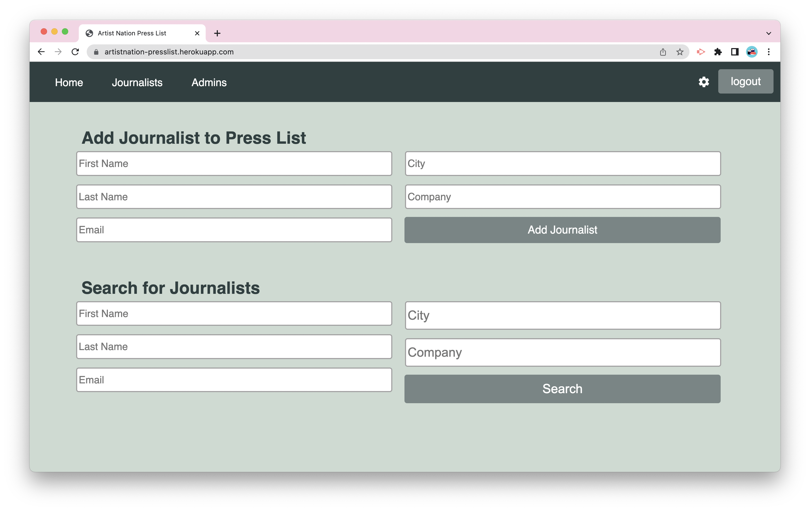

# Artist Nation Press List


## Description

This project is a full-stack application for Artist Nation to comprise and manage a press list. The application follows the MVC paradigm structure and is written in Javascript. It uses express to create a RESTful API for the controllers. MySQL along with sequelize ORM are used for the models. And Handlebars as a templating engine for the views. Express sessions and connect session sequelize packages are used to add authentication. Dotenv package used to store environment variables. Bcrypt package is used to hash passwords. Casual package is used to seed fake data.

  <br>

## Table of Contents

- [Installation](#installation)
- [Usage](#usage)
- [CSV import and export](#csv-import-and-export)
- [Tests](#tests)
- [License](#license)
- [Deployed Link](#deployed-link)

  <br>

## Installation

Use the following command to download dependencies for the project:

```
npm install
```

Use the following command to seed the database:

```
npm run seeds
```

  <br>

## Usage


</br>
The application allows admins the ability to login and manage a press list. Once logged in, on the homepage admins have the ability to add a journalist to the press list. They have the option to search the press list based on first name, last name, company, email and or city, with an auto-complete feature for each field, or they can view all the journalist using the journalist tab. The entire press list or the refined searched press list can be sorted in ascending order by all categories and give the option to email a single journalist, or all of the journalist listed through their email browser. They have the ability to edit or delete each journalist. There is a settings feature for the admin to change their username and password, and a single designated admin has the option to manage other admins, with ability to add and delete other admins.
</br>

## CSV import and export

The **Journalists** page has an Export / Import toolbar. Both require a logged-in session.

**Export.** "Export CSV" downloads the list currently on screen — if you arrived via a search or a
sort, the same filter is applied to the export. UTF-8 with a BOM so Excel reads accented names
correctly, and fields beginning `=`, `+`, `-` or `@` are prefixed with an apostrophe so a display
name can never execute as a spreadsheet formula.

**Import.** Pick a `.csv`, choose what to do with emails already on the list, and upload.
"Preview only" is ticked by default: it validates the whole file and reports what *would* happen
without writing anything. Untick it to import for real.

Expected columns (order does not matter, case and punctuation are ignored):

| Column | Required | Also accepted as |
| --- | --- | --- |
| First Name | yes | `first_name`, `firstname`, `first`, `given name` |
| Last Name | yes | `last_name`, `lastname`, `last`, `surname` |
| Email | yes | `email address`, `e-mail` |
| Company | no | `outlet`, `publication`, `organization` |
| City | no | `location`, `town` |

"Download blank template" gives you an empty file with the right headers. Unrecognised columns are
reported and ignored — only the five fields above are ever written, so an `id` column in the file
cannot overwrite a primary key.

Rows are validated individually: a file with two bad rows imports the rest and tells you which
lines failed and why. Duplicate emails inside one file are collapsed to the first occurrence.
Emails already on the list are matched case-insensitively. The limit is 5,000 rows per file.

API, if you'd rather script it:

```
GET  /api/journalists/export.csv[?city=London&company=...]
GET  /api/journalists/import-template.csv
POST /api/journalists/import[?dryRun=1][&mode=update]     # body: text/csv, or JSON { "csv": "..." }
```

`POST /import` returns a JSON report: counts of created / updated / skipped, plus `invalid`,
`duplicatesInFile`, `failed` and `unknownColumns` with source line numbers.

  <br>

## Tests

```
npm test
```

Runs the Node built-in test runner against `test/` — no test framework dependency. Covers the CSV
parser/serializer, the import validation rules, and the journalist API routes (mounted on a real
Express app with an in-memory stand-in for the model, so no MySQL instance is needed).

  <br>

## License

This project is licensed under the [MIT License](https://choosealicense.com/licenses/mit/).  
 </br>

## Deployed Link

https://agile-refuge-70111.herokuapp.com/
</br>
